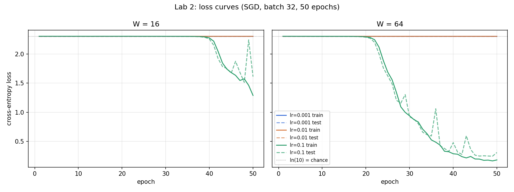

# Lab 2 — A neural network from scratch

Two-hidden-layer network in NumPy only (no autograd), trained on `load_digits`. Python 3.11, NumPy 1.26.4, CPU.

```bash
cd lab02/src
python task1_dataset.py      # ... through task7_timing.py, one script per task
```

| File | Content |
|---|---|
| `src/common.py`, `src/model.py` | data split, init, forward, softmax, cross-entropy, backward |
| `src/task1_dataset.py` … `src/task7_timing.py` | one script per task |
| `design.md`, `network_design.html` | Task 2 network design (interactive diagram in the HTML) |
| `gradients.md` | Task 5 hand derivation of the gradients |
| `results/` | `gradient_check.txt`, `training_log.csv`, `final_accuracy.csv`, `loss_curves.png`, `timing.csv` |

## 1. Dataset

`load_digits(return_X_y=True)`: 1,797 images of 8×8 pixels, 64 features, 10 classes.
Pixels are divided by 16, so they lie in [0, 1]. Labels are one-hot encoded to (N, 10).
The split is 70/30, stratified, with `random_state=42`.

| | X | Y (one-hot) |
|---|---|---|
| Train | (1257, 64) | (1257, 10) |
| Test | (540, 64) | (540, 10) |

Stratification keeps every digit at 9.6–10.2% of both splits. Every one-hot row sums to 1.

## 2. Network design

The full design, with equations, shape checks and the reasoning behind the initialisation, is in [`design.md`](design.md). The interactive diagram is [`network_design.html`](network_design.html).

```
X (B,64) → [W1,b1] → ReLU → [W2,b2] → ReLU → [W3,b3] → softmax → P (B,10)
```

| Param | Shape | W = 16 | W = 64 |
|---|---|---:|---:|
| W1 / b1 | (64,W) / (W,) | 1,024 / 16 | 4,096 / 64 |
| W2 / b2 | (W,W) / (W,) | 256 / 16 | 4,096 / 64 |
| W3 / b3 | (W,10) / (10,) | 160 / 10 | 640 / 10 |
| **Total** | W² + 76W + 10 | **1,482** | **8,970** |

Weights are drawn from N(0, 0.01), where 0.01 is the standard deviation. The measured std is 0.00983 for W=16 and 0.00997 for W=64. Biases start at 0.
`task2_design.py` checks every shape and count.

## 3. Forward pass

The forward pass is implemented layer by layer in `model.forward`. Softmax subtracts the row maximum before `exp` for numerical stability.
On logits [1000, 1001, 1002] the stable version returns [0.090, 0.245, 0.665], while the naive version returns NaN.

| Input | W = 16 | W = 64 |
|---|---|---|
| 1 sample (1,64) | P (1,10), max\|rowsum−1\| = 2.2e-16 | P (1,10), 2.2e-16 |
| mini-batch (32,64) | P (32,10), 2.2e-16 | P (32,10), 3.3e-16 |
| test set (540,64) | P (540,10), 2.2e-16 | P (540,10), 4.4e-16 |

Every output has shape (batch, 10), and every row sums to 1 within 4.4e-16, well inside the 1e-6 tolerance. **All checks passed.**

The tiny initial weights shrink the signal at every layer. Mean |Z| falls from 3e-2 at layer 1 to about 1e-5 at layer 3 (W=16), so the untrained softmax is uniform: P[0] = 0.1 for every class.

## 4. Cross-entropy loss

`L = −(1/B) Σ Σ Y·log(P + 1e-12)`. The ε keeps the loss finite when a probability is exactly 0.

| Untrained net | Train loss | Test loss | Target ln(10) |
|---|---:|---:|---:|
| W = 16 | 2.3026 | 2.3026 | 2.3026 |
| W = 64 | 2.3026 | 2.3026 | 2.3026 |

All four losses are within 1e-5 of ln(10), as expected for a uniform 10-class prediction. **Sanity check passed.**

## 5. Gradients and numerical check

The chain-rule derivation is in [`gradients.md`](gradients.md). It starts from the combined softmax + cross-entropy gradient `dZ3 = (P − Y)/B`, and every layer then repeats `dW = (input)ᵀ·dZ`, `db = Σ dZ`, `d(input) = dZ·Wᵀ`, with ReLU acting as a 0/1 mask.

To check the analytic gradients, 10 random weights per width were nudged by ±1e-5 and compared with the central difference `[L(w+h) − L(w−h)] / 2h`, using `rel_err = |a − n| / (|a| + |n|)` (`results/gradient_check.txt`).

| Width | Passed (< 1e-6) | Largest rel. error | Robustness: 20 other samples |
|---|---|---:|---|
| W = 16 | **10 / 10** → PASS | 9.5e-07 | 18 / 20 pass (≥ 9 of 10) |
| W = 64 | **10 / 10** → PASS | 6.4e-07 | 20 / 20 pass |

The check uses one sample. With float64, a loss near 2.3 carries rounding noise of about 1e-11 in the numerical slope.
Averaging over a batch divides every gradient by B. With B = 32 the median gradient is 1.4e-5, against 9.7e-5 for one sample, so rounding noise alone pushes many checks above 1e-6.
The measured pass rates were 95/100 for B=1, 82/100 for B=8 and 74/100 for B=32.
The occasional failure for one sample is a weight with a very small gradient (about 8e-6), or a ReLU input that crosses 0 between w−h and w+h, where the loss is not smooth. Neither is a bug in the formula.

## 6. Training

Plain SGD: the data is reshuffled every epoch, mini-batches have 32 rows (the last one has 9), training runs 50 epochs, and loss and accuracy are logged after every epoch (`results/training_log.csv`).
All six runs start from the same seed-42 weights.



**Final test accuracy (epoch 50)** (`results/final_accuracy.csv`)

| Width | lr | Train loss | Test loss | Train acc | Test acc |
|---|---|---:|---:|---:|---:|
| 16 | 0.001 | 2.3026 | 2.3025 | 0.1018 | 0.1019 |
| 16 | 0.01 | 2.3027 | 2.3025 | 0.1018 | 0.1019 |
| 16 | 0.1 | 1.2883 | 1.6117 | 0.4956 | 0.5037 |
| 64 | 0.001 | 2.3025 | 2.3025 | 0.1018 | 0.1019 |
| 64 | 0.01 | 2.3025 | 2.3023 | 0.1018 | 0.1019 |
| 64 | **0.1** | **0.1824** | **0.3096** | **0.9340** | **0.9056** |

- **lr = 0.001 and 0.01 do not learn in 50 epochs.** The loss stays at ln(10) and accuracy stays at chance (10%).
  N(0, 0.01) weights make the gradients reaching W1 and W2 tiny, because each backward step multiplies by a weight matrix of size about 0.01. Small steps then cannot escape the flat region around the uniform prediction.
  This was the trade-off predicted in `design.md`.
- **lr = 0.1 escapes the plateau.** W=64 leaves it around epoch 20 (train loss below 2.2 at epoch 23) and reaches 90.6% test accuracy (best epoch 93.5%). W=16 only leaves it around epoch 40, and reaches 50.4% at epoch 50 while still improving.
- **The wider network learns sooner** because more hidden units give a larger total gradient signal through W2 (W² weights).
- The test curve for lr = 0.1 is noisy (spikes at epochs 36 and 43 for W=64, and 49 for W=16). With one fixed step size, some SGD updates overshoot. A larger init std (e.g. He init) or more epochs would let the smaller learning rates train too, but the manual fixes N(0, 0.01) and 50 epochs, so those were kept.

## 7. Forward vs backward timing

Each pass was timed separately: 10 warm-up runs, then the median of 100 runs with `time.perf_counter` (`results/timing.csv`).
FLOPs count only the matrix products (2·m·k·n each). Forward has 3 products. Backward has 5: dW3, dA2, dW2, dA1, dW1, with no dX for the input.

| Width | Batch | Forward ms | Backward ms | Bwd / fwd time | Bwd / fwd FLOP | Matmul share fwd / bwd |
|---|---:|---:|---:|---:|---:|---|
| 16 | 32 | 0.075 | 0.087 | 1.16 | 1.29 | 26% / 34% |
| 16 | 1257 | 1.339 | 1.504 | 1.12 | 1.29 | 51% / 66% |
| 64 | 32 | 0.137 | 0.193 | 1.41 | 1.54 | 42% / 42% |
| 64 | 1257 | 3.670 | 4.857 | 1.32 | 1.54 | 44% / 58% |

**The backward pass dominates in every configuration (1.1× to 1.4× the forward time).** The cause is matrix multiplication. Each layer needs one product in the forward pass (`input·W`), but two in the backward pass: `inputᵀ·dZ` for the weight gradient and `dZ·Wᵀ` to pass the error to the layer below.
Only the first layer skips the second product, because the input X needs no gradient. That gives backward/forward FLOP ratios of

- W = 16: (20W + 2W² + 64W) / (74W + W²) = 1,856 / 1,440 = **1.29**
- W = 64: 1.54, because the W×W layer, which is counted twice in backward, takes a larger share as W grows.

The measured time ratios follow the FLOP ratios: both are higher for W=64 than for W=16, and the time ratio is a little lower in each case.
The difference is the non-matmul work. Forward has `exp` in the softmax and the ReLU, and backward has the ReLU masks and the bias sums. These element-wise operations are relatively expensive at these tiny sizes.
At batch 32, the matrix products are only 26–42% of each pass, so NumPy call overhead and element-wise work dominate. At the full batch of 1,257, matmuls take over in backward (58–66%).
Throughput rises with size, from 1.2 GFLOP/s (W=16, B=32) to 7.0 GFLOP/s (W=64, B=1257, backward). Bigger matrices keep BLAS busy, which is why backpropagation cost scales with the matrix-multiply count rather than the number of layers.
