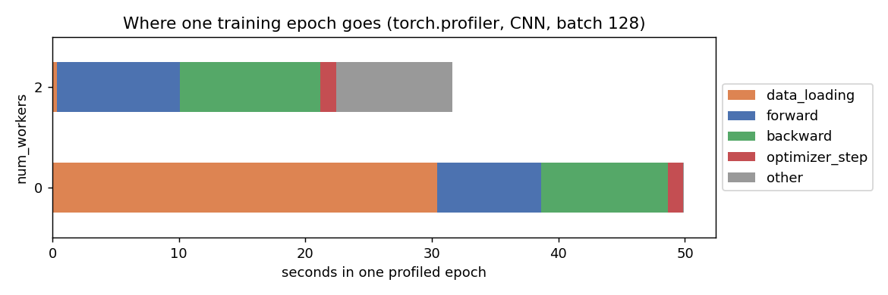
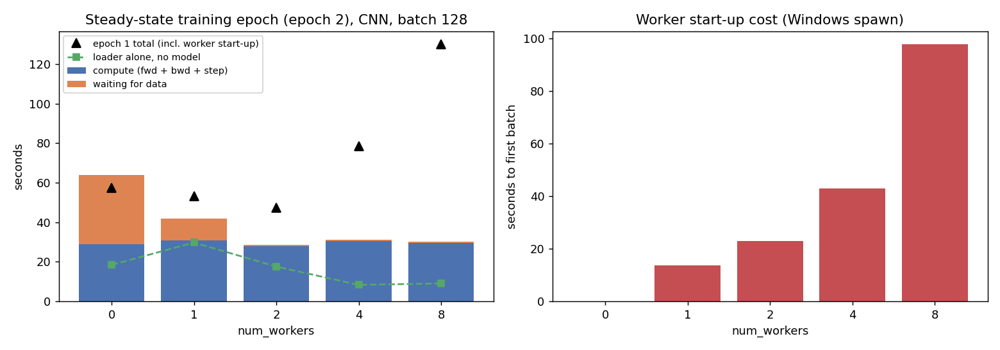
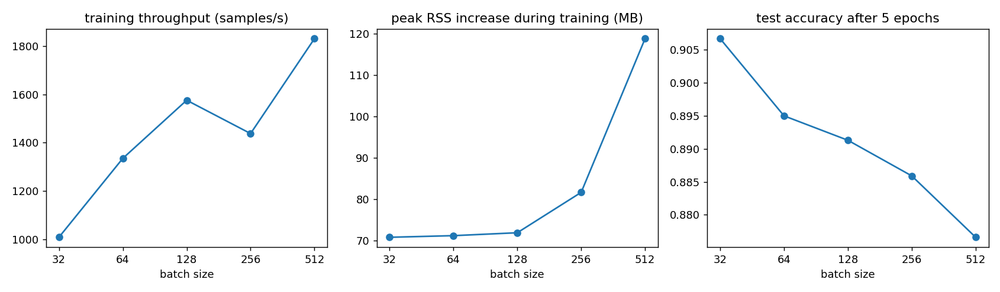
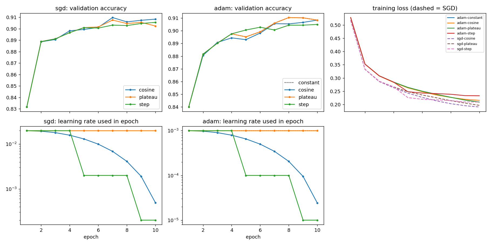
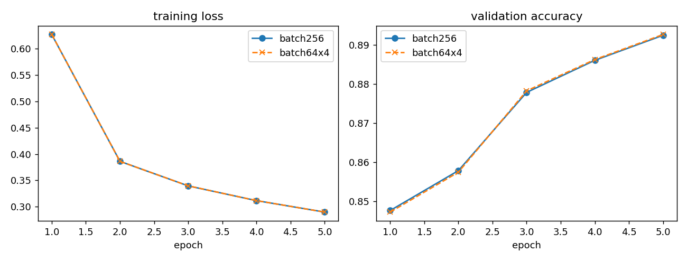
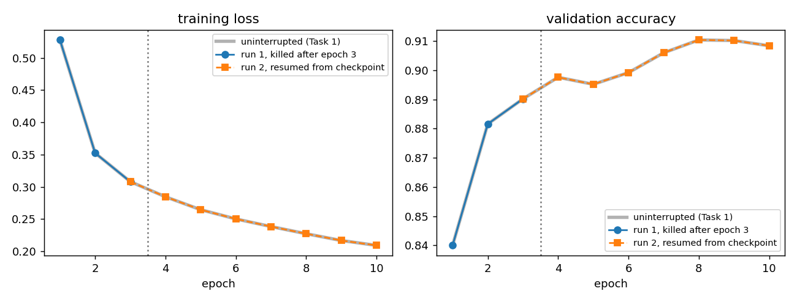

# Lab 6 — Training pipelines and project proposal

The Lab 3 CNN (Conv16-Pool-Conv32-Pool-Linear, 20,490 parameters, Fashion-MNIST) moved into a YAML-driven training
script with seeding, checkpoints and MLflow, then used to study where training time goes and how workers, batch size,
optimizer, schedule and gradient accumulation change it. Python 3.11, PyTorch 2.3.1 (CPU), MLflow 2.14.1, Windows 11,
4 physical / 8 logical cores, `threads: 4` for every run.

```bash
python lab06/src/run_all.py                    # every task (about 1.5 h), or the task*.py scripts one by one
python lab06/src/train.py --set optimizer.name=sgd --set optimizer.lr=0.02   # one run, any config key
mlflow ui --backend-store-uri lab06/mlruns     # browse the runs (store is git-ignored, exported to results/)
```

| File | Content |
|---|---|
| `config.yaml` | the single config: seed, data, model, training, optimizer, scheduler, checkpoint, mlflow |
| `src/train.py` | Task 1 training script (`--set key=value` overrides, `--resume`) |
| `src/common.py` | config loading, seeds, model, loaders, evaluation, peak-RSS sampler, `run_training` |
| `src/task2_profile.py` … `src/task7_resume.py` | one script per task; `src/export_mlflow.py` writes `results/mlflow_runs.csv` |
| `results/` | CSV + PNG per task, `profile_ops_workers*.txt`, `mlflow_runs.csv`, `run_output.txt` |
| `proposal.md` | Task 8, individual project proposal |

## 1. YAML-driven pipeline with seed, checkpoints and MLflow

`train.py` reads only `config.yaml`. Command-line `--set a.b=value` edits a key that already exists (an unknown key
is an error, not a silent no-op), so every study below is the same script with a few overrides.

| Requirement | How it is done |
|---|---|
| Single config object | one nested dict from `config.yaml`; the whole dict is logged to MLflow as params (flattened) and as a `config.yaml` artifact |
| Seed | `seed: 42` → `random`, `numpy`, `torch`; the train/val split and the shuffle order use their own seeded generators |
| Checkpoints | `checkpoints/<run_name>/last.pt` after every epoch: model, optimizer, scheduler, history, MLflow run id and **all RNG states incl. the shuffle generator**. Written to a temp file then renamed, so a crash mid-write never corrupts it |
| MLflow | params (all config keys), per-epoch metrics (`train_loss`, `val_loss`, `val_acc`, `lr`, `throughput`, `epoch_seconds`, `data_wait_seconds`), final `test_acc`, `peak_rss_mb`; artifacts `config.yaml`, `history.csv`, `model.pt`; tag `n_params` |

Baseline (`config.yaml` as committed: Adam 1e-3, batch 128, 10 epochs, 2 workers): **test accuracy 90.32 %**
(Lab 3 reached 89.73 % with the same recipe in 5 epochs; this run trains 10). 20 runs in 6 experiments are in MLflow (`results/mlflow_runs.csv`).

## 2. Profiling one epoch

`torch.profiler` over one full epoch, each phase wrapped in `record_function`. Profiling every op of an epoch as one
trace (with 0 workers each per-sample `ToTensor`/`Normalize` is an op too) made `key_averages()` grow past 6 GB and
stall, so the epoch is profiled in back-to-back windows of 50 steps (`schedule(wait=0, warmup=0, active=50)`), each
summarised and freed when it closes. All steps are still covered; the time `prof.step()` spends closing windows is
profiler overhead and is excluded from the wall time (386 s with 0 workers, 30 s with 2).

| Phase | 0 workers (s) | share | 2 workers (s) | share |
|---|---|---|---|---|
| data loading | 30.41 | **60.9 %** | 0.33 | 1.1 % |
| forward | 8.21 | 16.4 % | 9.74 | 30.8 % |
| backward | 10.04 | 20.1 % | 11.09 | **35.1 %** |
| optimizer step | 1.21 | 2.4 % | 1.29 | 4.1 % |
| other | 0.07 | 0.1 % | 9.13 | 28.9 % |
| **epoch** | **49.9** | | **31.6** | |



- With the Lab 3 setup (0 workers) **the model spends 61 % of the epoch waiting for data**: the main process decodes
  and normalises every image itself, one at a time. Forward + backward + step is only ~19 s.
- With 2 workers the data is prepared in parallel and `next()` returns in ~1 ms; compute (forward 31 %, backward 35 %)
  is now the epoch. "Other" is `iter(train_loader)` spawning the two worker processes (Windows `spawn` re-imports
  torch in each), a one-off cost that `persistent_workers: true` pays once per run, not per epoch.
- Backward costs ~1.2× forward; the Adam step is small (20k parameters). The top ops (`results/profile_ops_workers2.txt`)
  are `convolution_backward` (28 %), `max_pool2d` (24 %), `mkldnn_convolution` (13 %) and the ReLU backward (11 %).

## 3. num_workers ∈ {0, 1, 2, 4, 8}

Same model and data. *Start-up* = `iter()` to first batch; *loader only* = iterating the loader with no model;
*epoch 2* = a training epoch after start-up, split into time blocked on `next()` (data wait) and compute.

| workers | start-up (s) | loader only (samples/s) | epoch 1 (s) | epoch 2 (s) | data wait in epoch 2 | throughput (samples/s) |
|---|---|---|---|---|---|---|
| 0 | 0.1 | 2,984 | 57.4 | 63.7 | **54.5 %** | 863 |
| 1 | 13.5 | 1,850 | 53.1 | 42.0 | 26.6 % | 1,311 |
| **2** | 22.9 | 3,131 | **47.4** | **28.6** | **2.0 %** | **1,924** |
| 4 | 42.9 | 6,613 | 78.6 | 31.1 | 1.8 % | 1,766 |
| 8 | 97.8 | 6,089 | 130.1 | 30.3 | 2.3 % | 1,816 |



**The bottleneck at 0–1 workers is data loading** (55 % / 27 % of the epoch waiting); from 2 workers on it is
compute (~28–30 s of forward/backward/step regardless of workers). More workers only add start-up, which on Windows is
~10 s per worker, and contend with the 4 training threads for the 4 physical cores (epochs 4–8 are not faster than
2). `num_workers: 2` is the committed choice.

## 4. Batch size ∈ {32, 64, 128, 256, 512}, 5 epochs, Adam 1e-3

| batch | optimizer steps | throughput (samples/s) | train time (s) | peak RSS increase (MB) | final val acc | test acc |
|---|---|---|---|---|---|---|
| 32 | 8,595 | 1,008 | 281 | 70.8 | 91.08 % | **90.67 %** |
| 64 | 4,300 | 1,334 | 216 | 71.2 | 90.18 % | 89.50 % |
| 128 | 2,150 | 1,575 | 185 | 71.9 | 89.52 % | 89.13 % |
| 256 | 1,075 | 1,437 | 198 | 81.6 | 89.24 % | 88.59 % |
| 512 | 540 | **1,831** | **161** | **118.8** | 88.04 % | 87.66 % |



- **Throughput rises with batch size** (1,008 → 1,831 samples/s, +82 %): per-batch Python, dispatch and optimizer
  overhead is paid 16× less often, and larger matrices use the 4 threads better. 256 being below 128 is run-to-run
  noise on this laptop (the baseline's own epochs vary from 29 s to 48 s).
- **Peak memory** is flat up to 128 and then grows (+82 MB at 256, +119 MB at 512): it is activations, which scale with
  batch. The ~355 MB baseline RSS (PyTorch, dataset) dominates at this model size.
- **Accuracy falls with batch size** at a fixed LR and a fixed 5 epochs: batch 512 makes 16× fewer updates than
  batch 32 (540 vs 8,595) with the same step size, so it is simply less trained (train loss 0.33 vs 0.22). Fair
  large-batch training would scale the LR or train longer; here the trade-off is −3.0 points of accuracy for 1.8×
  throughput.

## 5. LR schedules × optimizer, equal 10-epoch budget

Same seed, data order, initial weights, batch 128, 10 epochs. SGD lr 0.02 momentum 0.9, Adam lr 1e-3.
StepLR (step 4, γ 0.1), CosineAnnealingLR (T_max 10), ReduceLROnPlateau (factor 0.1, patience 1 on val loss).

| optimizer | schedule | LR in last epoch | final train loss | final val acc | best val acc (epoch) | test acc |
|---|---|---|---|---|---|---|
| SGD+momentum | StepLR | 2.0e-4 | 0.209 | 90.56 % | 90.56 % (10) | 90.76 % |
| SGD+momentum | **Cosine** | 4.9e-4 | **0.191** | 90.84 % | 90.98 % (7) | **91.18 %** |
| SGD+momentum | Plateau | 2.0e-2 (never cut) | 0.197 | 90.24 % | 90.76 % (7) | 90.40 % |
| Adam | StepLR | 1.0e-5 | 0.233 | 90.50 % | 90.50 % (10) | 89.75 % |
| Adam | Cosine | 2.4e-5 | 0.216 | 90.84 % | 90.84 % (10) | 90.21 % |
| Adam | Plateau | 1.0e-3 (never cut) | 0.209 | 90.84 % | 91.04 % (8) | 90.32 % |
| Adam | constant (Task 1) | 1.0e-3 | 0.209 | 90.84 % | 91.04 % (8) | 90.32 % |



- **Best: SGD+momentum with cosine annealing, 91.18 %**, and SGD beats Adam for every schedule (lower train loss and
  higher test accuracy), the usual result for small CNNs when SGD's LR is reasonable.
- **Cosine is the best schedule for both optimizers**: the LR stays high early and anneals smoothly.
- **StepLR with step 4 is too aggressive for 10 epochs**, worst with Adam (89.75 %): after epoch 4 the LR is 1e-4,
  after epoch 8 1e-5, and the last 6 epochs barely move the weights (train loss stalls at 0.23).
- **ReduceLROnPlateau never acted.** Validation loss kept falling until epoch 8 and only rose at epochs 9 and 10, so
  with patience 1 the cut comes *after* the last epoch. Adam-plateau is therefore identical, bit for bit, to the
  constant-LR baseline — a useful check that the pipeline is deterministic. On a 10-epoch budget the plateau
  scheduler needs patience 0 or a longer run to matter.
- The train times (229–414 s) differ for the same amount of compute; that is machine noise, not the optimizer.

## 6. Gradient accumulation: batch 64 × 4 vs batch 256

`train_one_epoch` divides each micro-batch's summed loss by the size of its accumulation group and steps every
`accumulation_steps` micro-batches (including the shorter last group), so the accumulated gradient is the gradient of
the mean loss over 256 samples.

**One-step check** (same weights, first 256 samples): max |grad(256) − grad(64×4)| over all parameters = **1.3e-7**,
float32 rounding from a different summation order.

| epoch | train loss 256 | train loss 64×4 | val acc 256 | val acc 64×4 |
|---|---|---|---|---|
| 1 | 0.62689 | 0.62688 | 84.76 % | 84.72 % |
| 2 | 0.38616 | 0.38621 | 85.78 % | 85.74 % |
| 3 | 0.33961 | 0.33962 | 87.78 % | 87.82 % |
| 4 | 0.31163 | 0.31167 | 88.60 % | 88.62 % |
| 5 | 0.28988 | 0.28986 | 89.24 % | 89.26 % |

| run | optimizer steps | throughput (samples/s) | peak RSS increase | test acc |
|---|---|---|---|---|
| batch 256 | 1,075 | 1,498 | 81.7 MB | 88.59 % |
| batch 64 × 4 | 1,075 | 1,332 | **71.0 MB** | 88.63 % |



**Training behaviour is the same**: identical number of optimizer steps, train loss within 5e-5, validation accuracy
within 0.04 points (2 of 5,000 images) at every epoch, test accuracy within 0.04 points. The tiny drift is the 1e-7
rounding difference compounding over 1,075 steps. Accumulation buys the memory of batch 64 (−11 MB of activations)
for ~11 % less throughput (four smaller matmuls instead of one).

## 7. Interrupt at epoch 3, resume

`training.interrupt_after_epoch=3` makes `train.py` save the epoch-3 checkpoint and then `os._exit(3)` — no cleanup,
MLflow run left open, like a killed job. `--resume` reloads weights, Adam moments, scheduler, history, Python/NumPy/
torch RNG and the **shuffle generator**, and reopens the same MLflow run (tag `resumed_at_epoch=4`).

| epoch | leg | train loss resumed | train loss uninterrupted | val acc resumed | val acc uninterrupted |
|---|---|---|---|---|---|
| 1–3 | before crash | 0.52792 / 0.35240 / 0.30800 | 0.52792 / 0.35240 / 0.30800 | 84.00 / 88.16 / 89.02 % | 84.00 / 88.16 / 89.02 % |
| 4 | after resume | 0.28448 | 0.28448 | 89.76 % | 89.76 % |
| 7 | after resume | 0.23827 | 0.23827 | 90.60 % | 90.60 % |
| 10 | after resume | 0.20903 | 0.20902 | 90.84 % | 90.84 % |



The curves continue smoothly **and coincide with the uninterrupted Task 1 run**: validation accuracy is identical at
all 10 epochs, train loss differs by ≤ 5e-6 (the reference CSV is rounded to 5 decimals), and the final test accuracy
is the same 90.32 %. Restoring only the weights would not achieve this: Adam's moment estimates and the data order
after epoch 3 would both differ.

## 8. Project proposal

`proposal.md`: on-device keyword spotting (Google Speech Commands v2, 12 classes) with a DS-CNN, ≥ 90 % accuracy,
≤ 50 ms latency including feature extraction, ≤ 5 MB, int8 quantization (static PTQ, QAT as fallback).

## Conclusions

- The pipeline makes every experiment a config override, logged and reproducible: resume and the plateau run both
  reproduce the baseline exactly.
- With per-sample transforms in the main process, **data loading is 61 % of an epoch**; 2 workers remove it, and more
  workers only add start-up cost on a 4-core Windows machine.
- Bigger batches buy throughput (+82 % from 32 to 512) at the price of memory and, at a fixed LR and epoch budget,
  accuracy (−3 points). Gradient accumulation reproduces the large-batch training curve with the small-batch memory.
- Under an equal 10-epoch budget SGD+momentum with cosine annealing is best (91.18 %); a step schedule that decays too
  early and a plateau schedule that never fires are both visible in the LR curves.
